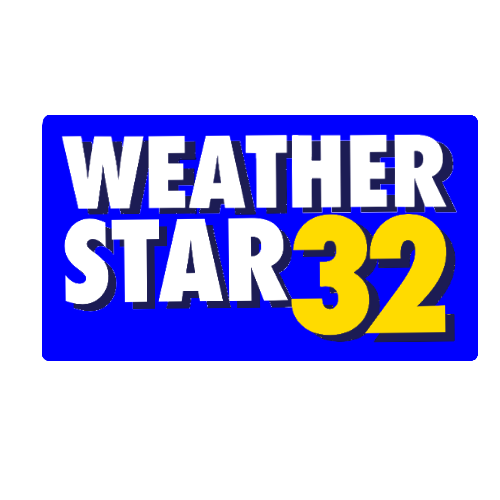

<!-- Improved compatibility of back to top link: See: https://github.com/othneildrew/Best-README-Template/pull/73 -->

<!--
*** Thanks for checking out the Best-README-Template. If you have a suggestion
*** that would make this better, please fork the repo and create a pull request
*** or simply open an issue with the tag "enhancement".
*** Don't forget to give the project a star!
*** Thanks again! Now go create something AMAZING! :D
-->

<!-- PROJECT SHIELDS -->
<!--
*** I'm using markdown "reference style" links for readability.
*** Reference links are enclosed in brackets [ ] instead of parentheses ( ).
*** See the bottom of this document for the declaration of the reference variables
*** for contributors-url, forks-url, etc. This is an optional, concise syntax you may use.
*** https://www.markdownguide.org/basic-syntax/#reference-style-links
-->
[![Stargazers][stars-shield]][stars-url]
[![Issues][issues-shield]][issues-url]

<!-- PROJECT LOGO -->
 

  

  <h3 align="center">Weather Star 32</h3>

  

    Embedded-system retro weather reborn!
  

<!-- TABLE OF CONTENTS -->

  
Table of Contents

  <ol>
    <li>
      <a href="#about-the-project">About The Project</a>
      <ul>
        <li><a href="#built-with">Built With</a></li>
      </ul>
    </li>
    <li><a href="#acknowledgements">Acknowledgements</a></li>
    <li><a href="#license">License</a></li>
  </ol>

<!-- ABOUT THE PROJECT -->
## About The Project

The Weather Star 32 is a weather monitoring device that runs on an ESP32 SoC. All you need to enter is your latitude and longitude and you'll be able to monitor the weather as if you're back in the 90s. This project takes inspiration from the Weather Star 4000, a custom machine built by the Weather Channel to display local weather data on cable TVs nation-wide from 1990-2014. 

The Weather Star 4000 was a RAM-based system in that all of its code and data was received via satellite and stored directly in RAM. The Weather Star 32 is similar, but stores its code locally on the MCU itself. The Weather Star 32 receives data via
HTTP from the National Weather Service's public API, which is linked in <a href="#acknowledgements">Acknowledgements</a>.

### Built With
* Xtensa C
* FreeRTOS
* ESP-WROOM-32 MCU

(<a href="#readme-top">back to top</a>)

<!-- Acknowledgements -->

## Acknowledgements
* The NOAA and National Weather Service's public API, which can be found [here](https://api.weather.gov/).
* [jef-sure](https://github.com/jef-sure) for [esp32-component-dgx](https://github.com/jef-sure/esp32-component-dgx) for display functions.

<!-- LICENSE -->
## License

Distributed under the Unlicense License. See `LICENSE.txt` for more information.

(<a href="#readme-top">back to top</a>)

<!-- MARKDOWN LINKS & IMAGES -->
<!-- https://www.markdownguide.org/basic-syntax/#reference-style-links -->
[stars-shield]: https://img.shields.io/github/stars/othneildrew/Best-README-Template.svg?style=for-the-badge
[stars-url]: https://github.com/jsnyder17/weather-star-32/stargazers
[issues-shield]: https://img.shields.io/github/issues/othneildrew/Best-README-Template.svg?style=for-the-badge
[issues-url]: https://github.com/jsnyder17/weather-star-32/issues
